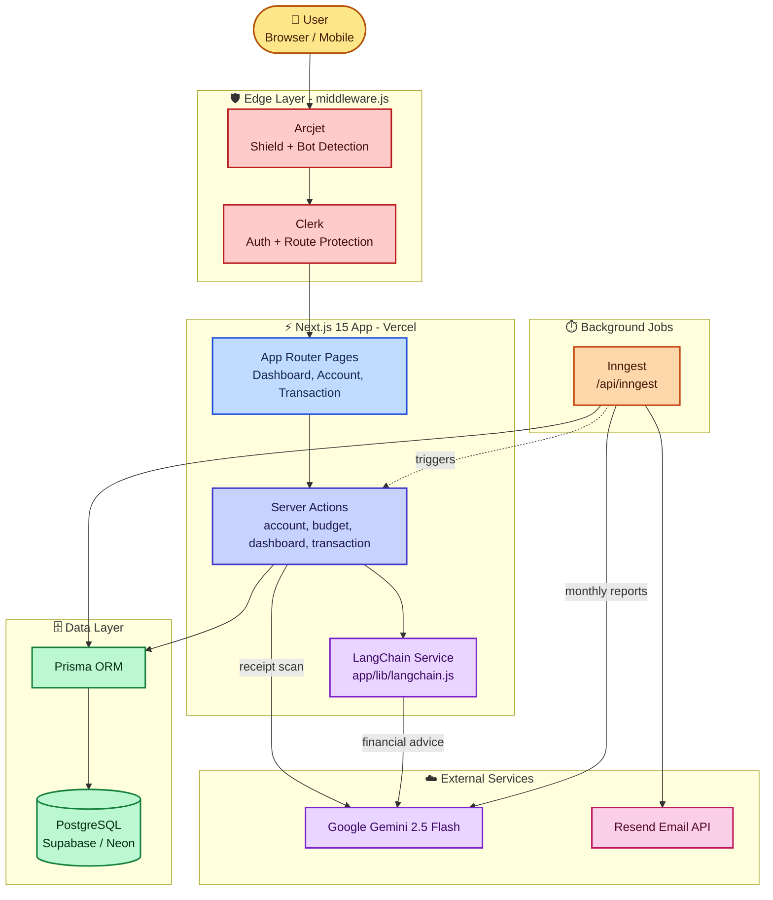
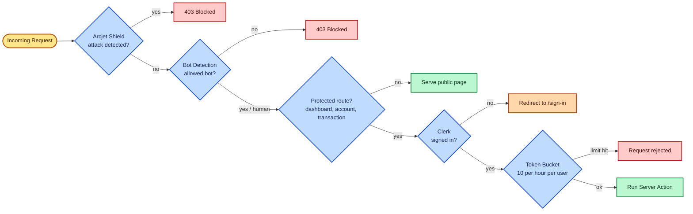
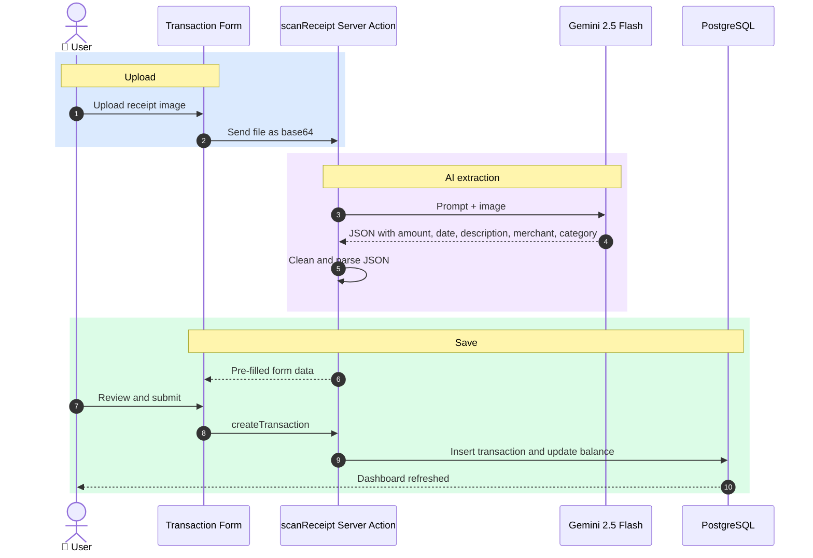
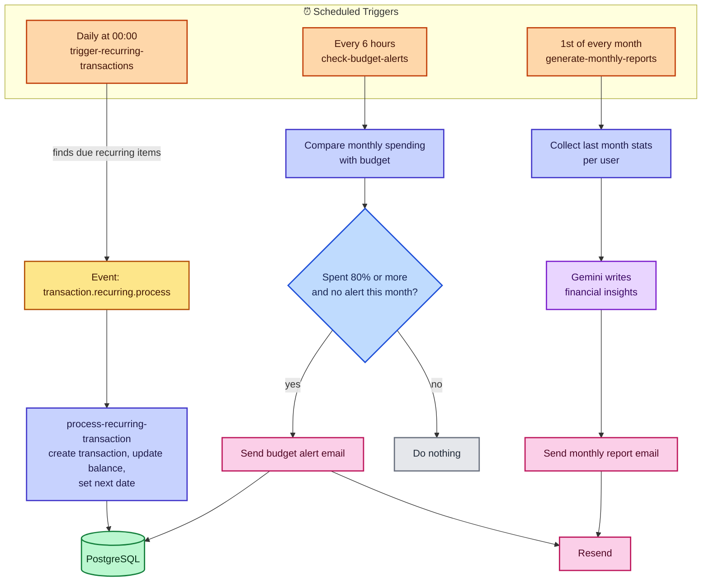
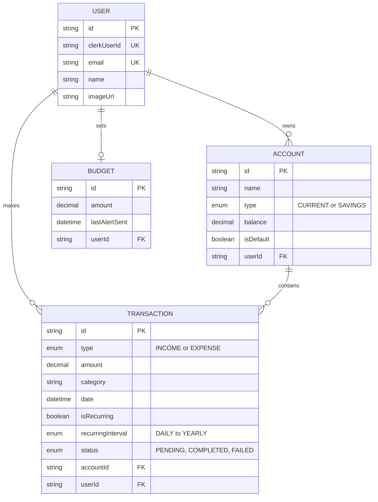
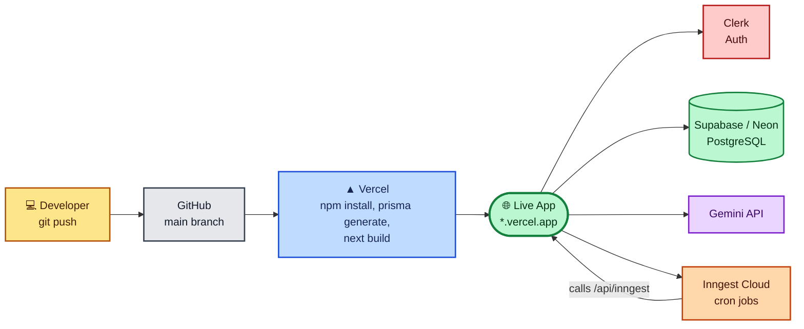

# AI Sentinel Finance

An AI-powered financial intelligence platform built for the AI Hackathon. AI Sentinel Finance uses Gemini and LangChain to turn raw transaction data into actionable insights, with automated budgeting, smart receipt scanning, and real-time financial health monitoring.

**Live Demo:** `https://your-app.vercel.app`

---

## Hackathon Submission: AI-Based Finance Project

AI Sentinel Finance bridges the gap between manual expense tracking and automated financial literacy. It combines Prisma for reliable data modeling, LangChain for AI orchestration, and Arcjet for security and rate limiting, giving users a secure, scalable and intelligent personal finance assistant.

### Core AI Features

* **Smart Receipt Extraction**: Upload a receipt image and Gemini extracts the amount, merchant, date and category automatically.
* **Automated Categorization**: AI-driven classification of expenses into logical spending categories.
* **Predictive Insights**: LangChain-powered analysis of spending habits to help users optimize their monthly budget.
* **AI Financial Advisor**: Personalized, data-driven recommendations generated through structured AI chains, with a rule-based fallback when the AI is unavailable.
* **Monthly Reports and Budget Alerts**: Scheduled background jobs (Inngest) generate AI-written monthly summaries and email alerts when spending nears the budget.

---

## Tech Stack

| Layer | Technology |
| --- | --- |
| Framework | Next.js 15 (App Router) |
| Styling | Tailwind CSS, Shadcn UI |
| Database | PostgreSQL with Prisma ORM |
| Auth | Clerk |
| AI Orchestration | LangChain.js |
| Model | Gemini 2.5 Flash |
| Background Jobs | Inngest |
| Email | Resend |
| Security | Arcjet (bot protection, shield, rate limiting) |
| Deployment | Vercel (Docker also supported) |

---

## Architecture

All diagrams below are written in Mermaid and render automatically on GitHub.

### 1. System Overview



### 2. Request Security Flow

Every request passes through Arcjet first, then Clerk. Account and transaction creation add a per-user rate limit.



### 3. AI Receipt Scanner Flow



### 4. AI Insights Flow with Fallback

```mermaid
flowchart LR
    A(["Dashboard<br/>Generate Insights"]):::start --> B["generateInsights<br/>Server Action"]:::backend
    B --> C["getDashboardData<br/>recent transactions"]:::data
    C --> D["getFinancialAdvice<br/>LangChain chain"]:::ai
    D --> E["PromptTemplate<br/>Financial Advisor role"]:::ai
    E --> F["Gemini 2.5 Flash"]:::ai
    F --> G["StringOutputParser"]:::ai
    G --> H{"AI call<br/>succeeded?"}:::check
    H -->|"yes"| I["3 data-driven<br/>recommendations"]:::ok
    H -->|"no"| J["Fallback template<br/>rule-based summary"]:::warn
    I --> K(["Shown on Dashboard"]):::start
    J --> K

    classDef start fill:#fde68a,stroke:#b45309,stroke-width:2px,color:#451a03
    classDef backend fill:#c7d2fe,stroke:#4338ca,stroke-width:2px,color:#1e1b4b
    classDef data fill:#bbf7d0,stroke:#15803d,stroke-width:2px,color:#052e16
    classDef ai fill:#e9d5ff,stroke:#7e22ce,stroke-width:2px,color:#3b0764
    classDef check fill:#bfdbfe,stroke:#1d4ed8,stroke-width:2px,color:#172554
    classDef ok fill:#bbf7d0,stroke:#15803d,stroke-width:2px,color:#052e16
    classDef warn fill:#fed7aa,stroke:#c2410c,stroke-width:2px,color:#431407
```



### 5. Background Jobs (Inngest)



### 6. Database Schema



### 7. Deployment Pipeline



---

## Getting Started

### 1. Clone the Repository

```bash
git clone https://github.com/sourabhvamdevan/ai-finance-platform.git
cd ai-finance-platform
```

### 2. Install Dependencies

```bash
npm install
```

The project includes an `.npmrc` with `legacy-peer-deps=true` to resolve a peer dependency conflict between `react-day-picker` and `date-fns`.

### 3. Environment Configuration

Create a `.env` file in the root directory:

```env
# Database (use the pooled URL for DATABASE_URL, the direct URL for DIRECT_URL)
DATABASE_URL=
DIRECT_URL=

# Authentication (Clerk)
NEXT_PUBLIC_CLERK_PUBLISHABLE_KEY=
CLERK_SECRET_KEY=
NEXT_PUBLIC_CLERK_SIGN_IN_URL=/sign-in
NEXT_PUBLIC_CLERK_SIGN_UP_URL=/sign-up
NEXT_PUBLIC_CLERK_AFTER_SIGN_IN_URL=/dashboard
NEXT_PUBLIC_CLERK_AFTER_SIGN_UP_URL=/dashboard

# AI and third-party APIs
GEMINI_API_KEY=
RESEND_API_KEY=
ARCJET_KEY=

# Background jobs (required in production for Inngest)
INNGEST_EVENT_KEY=
INNGEST_SIGNING_KEY=
```

### 4. Database Initialization

```bash
npx prisma generate
npx prisma db push
```

### 5. Run the Development Server

```bash
npm run dev
```

Open [http://localhost:3000](http://localhost:3000).

To run background jobs locally, start the Inngest dev server in a second terminal:

```bash
npx inngest-cli@latest dev
```

---

## Deploying to Vercel

1. Push the repository to GitHub.
2. Create the database tables once from your machine: `npx prisma db push`.
3. In Vercel, choose **Add New, then Project**, and import the repository. The Next.js preset is detected automatically.
4. Add every variable from the environment section above under **Project Settings, then Environment Variables**, and deploy.
5. In the Clerk dashboard, add your `*.vercel.app` domain.
6. Install the Inngest integration from the Vercel Marketplace (or set the two Inngest keys), then sync `https://your-app.vercel.app/api/inngest`.

Notes:

* `ARCJET_KEY` is required. Without it, requests will fail in the middleware.
* The `/api/seed` route is disabled in production.
* Receipt uploads are limited to 4 MB to stay under Vercel's request body limit.

---

## Docker Deployment (Optional)

To run the app in a container, set `output: "standalone"` in `next.config.mjs`, then:

```bash
docker build -t ai-sentinel-finance .
docker run -p 3000:3000 --env-file .env ai-sentinel-finance
```

---

## Detailed Implementation: LangChain Service

The AI features are handled by a dedicated service layer built with LangChain, located at `app/lib/langchain.js`. This keeps prompt engineering and model chaining separate from the UI.

For a full breakdown of the setup, see [langchain_setup.md](./langchain_setup.md). It covers:

* Configuring the `ChatGoogleGenerativeAI` model.
* Defining prompt templates for financial reasoning.
* Implementing the `getFinancialAdvice` function with fallback logic.
* Integrating AI insights into the dashboard through Server Actions.

---

## Implementation Highlights

* **Server Actions**: Secure backend operations without separate API boilerplate.
* **AI Service Layer**: Reusable LangChain integration for structured financial reasoning.
* **Graceful Degradation**: A fallback summary is shown if the AI API is unavailable.
* **Responsive Dashboard**: A mobile-first UI for managing finances on the go.
* **Transactional Integrity**: Prisma transactions keep balances accurate during bulk deletes and updates.
* **Security by Default**: Arcjet shield and bot detection on all routes, plus per-user rate limiting on account creation.
* **Containerization**: Multi-stage Docker build on Alpine Linux with Next.js standalone output.

---

## Project Structure

```
actions/        Server actions (accounts, budgets, transactions, dashboard)
app/            Next.js routes, layouts and the LangChain service (app/lib)
components/     UI components (Shadcn)
lib/            Prisma, Arcjet, Inngest and helper utilities
prisma/         Database schema and migrations
emails/         React Email templates
```

---

## Author

**Sourabh** ([@sourabhvamdevan](https://github.com/sourabhvamdevan))
